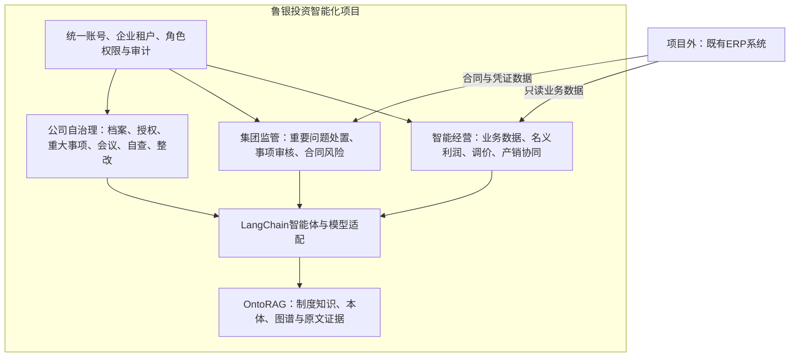
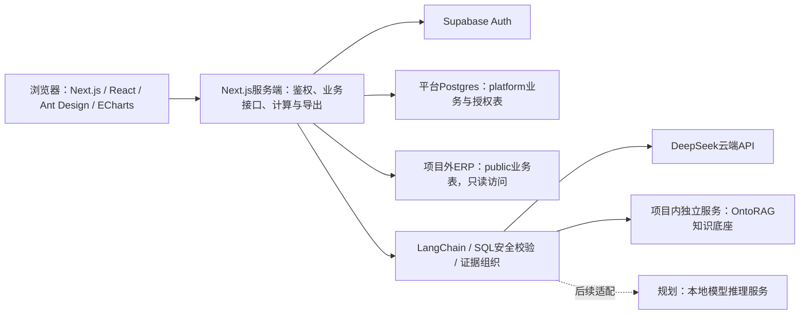
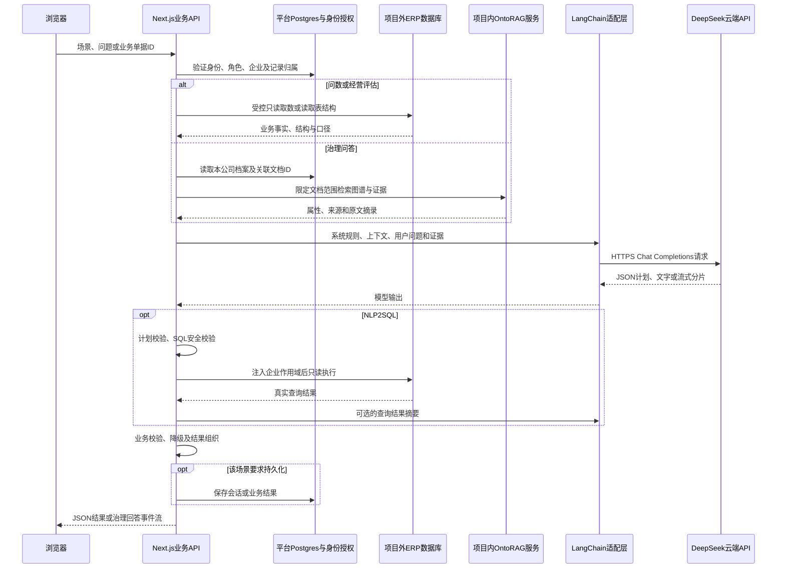

# 鲁银投资智能化平台

面向鲁盐管理方、工厂及合资公司的智能经营与企业治理平台，建设两大业务工作空间：**鲁银智能经营平台**、**鲁银监管与风控平台**。

项目以ERP业务事实为计算依据，以项目内OntoRAG知识底座提供制度与治理证据，以LangChain连接大模型形成分析和辅助建议，最终由有权限的人员作出业务决定。

> 文档基线：2026-11-06。本文区分当前实现与后续建设，不将模拟数据、规则命中或AI建议等同于真实业绩、违规认定或自动业务执行。历史PRD用于追溯；与本文冲突的旧阶段描述不作为当前实现依据。

## 1. 项目边界与业务架构

### 1.1 组织与职责

| 组织 | 定位 | 平台职责 |
|---|---|---|
| 鲁银 | 虚拟集团管理视角，不作为新增法人 | 项目品牌、集团经营分析与监管视角 |
| 鲁盐 | 管理方法人 | 管理工厂及合资公司，承接集团审核与监管 |
| 营销公司 | 鲁盐内部部门，不是独立法人 | 在明确的部门授权范围内开展经营业务 |
| 工厂 | 独立法人 | 查看本企业经营、库存和备货相关信息 |
| 合资公司 | 独立法人 | 经营分析、调价申请、企业治理与自查 |

企业上下级关系、法律主体关系和系统数据授权是三个不同概念。上级组织不因名称或树形层级自动取得全部数据权限；以平台成员、角色和授权企业集合为准。公司治理视角当前默认鲁盐泰安，仍受实际授权范围限制。

### 1.2 项目内外边界

- **项目内**：两大业务平台、平台业务数据库、身份与授权、智能体服务、OntoRAG知识与图谱底座，以及相应集成、部署和运维工作。
- **项目外**：既有ERP系统及其订单、成本、库存、合同和账务数据；ERP源数据维护由ERP责任方承担。
- **模型资源**：当前调用DeepSeek云端服务；本地模型推理服务属于后续可实施的项目内基础设施。
- **仓库边界**：本仓库包含业务应用及OntoRAG访问适配，OntoRAG本体平台另行部署维护。“项目内”指建设责任和业务能力边界，不代表其全部源码或数据存储已合并到本仓库。



### 1.3 两类业务闭环

**经营闭环**：ERP取数 → 确定性计算 → 报表与洞察 → 辅助建议 → 人工审核/反馈 → 平台记录留存。平台采纳建议不直接修改ERP价格、不自动创建销售、调拨或生产单。

**治理闭环**：公司档案与制度依据 → 治理动作生成/人工发起 → 上传材料 → 人工审核 → 归档或生成关联整改 → 整改反馈与复核。重要或保留事项提请集团；集团侧处理重要问题，不重复建设一套一般经营业务管理系统。

## 2. 技术架构

### 2.1 当前架构



| 层级 | 当前技术与职责 |
|---|---|
| 运行环境 | Node.js 24；Next.js 16.4.5 App Router；React 19 |
| 前端交互 | Ant Design、ECharts、响应式Web；React Markdown + GFM展示治理回答 |
| 服务接口 | Next.js Route Handlers，服务端处理身份、授权、数据库及模型调用 |
| 身份认证 | Supabase Auth；服务端验证身份并读取平台成员授权 |
| 数据访问 | postgres客户端直连Postgres，使用连接池、独立运行角色和事务 |
| 业务计算 | SQL、TypeScript与decimal.js；金额源字段按分转元，汇总避免浮点误差 |
| 智能体 | LangChain及@langchain/openai，以兼容Chat Completions协议接入DeepSeek |
| 知识底座 | 项目内OntoRAG独立服务；本体、实体关系、制度目录、属性与原文证据读取 |
| 安全校验 | Zod输入校验、SQL AST与函数白名单、企业作用域、操作权限和版本校验 |
| 文件与导出 | ExcelJS生成XLSX；治理附件当前存平台私有表，由鉴权接口下载 |
| 工程交付 | GitHub、Vercel、Supabase SQL迁移、Vitest和Playwright |

### 2.2 数据存储及物理部署现状

当前Auth、平台`platform`表及ERP `public`表位于同一个Supabase项目，使用不同数据库连接角色控制访问。这是**当前部署约束**，不改变ERP为项目外业务系统的责任边界，也不意味着Web URL与数据库连接串相同。

平台部分表直接关联`public.company`及`auth.users`。将ERP与平台拆分至两个数据库时，必须同步改造跨库JOIN、外键、企业映射及身份关联，不能仅修改环境变量完成拆分。

| 数据类型 | 存储及责任 |
|---|---|
| 订单、成本、库存、合同与账务 | ERP负责维护；平台只读查询，不通过模型写入 |
| 用户成员、角色、企业授权 | 平台表；Auth提供登录身份，业务权限由成员映射决定 |
| 调价批次、审核事件、AI评估 | 平台表；与ERP历史调价记录区分来源 |
| 产销建议处理、证据快照与事件 | 平台表；保存同意、否决、待定及理由 |
| 治理档案、动作、整改、材料与事件 | 平台表；演练样例与正式资料需区分 |
| 数据洞察会话 | 平台表，按用户和权限快照隔离；显式本地样例模式另用浏览器存储 |
| 制度知识及图谱 | OntoRAG服务维护，业务平台按公司关联文档检索 |

## 3. 功能清单

| 类别 | 模块 | 当前能力与边界 |
|---|---|---|
| 基础模块 | 账号与身份 | 登录、退出、成员绑定和账号启停；企业SSO需另行对接 |
| 基础模块 | 组织与企业租户 | 集团/公司/部门范围、企业成员授权、公司选择及隔离；不是独立数据库式租户 |
| 基础模块 | 角色权限 | 菜单、查看、申请、审核、导出及管理权限；集团监管/公司自治理视角切换不提升权限 |
| 基础模块 | 轻量后台 | 独立设置入口，用户权限、语义配置及连接检测 |
| 基础模块 | 流程与审计 | 逐行审核、状态流转、版本冲突、材料下载及办理事件；独立统一通知中心待建设 |
| 智能经营 | 业务数据 | 年度概览、销售月报、产品分类、销售日报、日/月趋势、占比、明细与下载 |
| 智能经营 | 名义利润 | 年度概览、产品贡献、公司利润对照、订单明细、成本覆盖率和集团简要洞察 |
| 智能经营 | 数据洞察助手 | 通用NLP2SQL、文字/表格/图表、历史会话、回车发送；12个权限相关常见问题，选择后只填入草稿 |
| 智能经营 | 调价辅助决策 | 多行申请、XLSX读取确认、整批AI评估、逐行独立审核及历史查询；依赖证据可用性 |
| 智能经营 | 产销协同建议 | 尾货、库存销售候选、工厂备货计划，详情证据、AI解释和处理记录 |
| 集团监管 | 总览与重要问题 | 聚焦重要风险与责任单位，提出整改、接收反馈及复核处置；不设独立整改督办菜单 |
| 集团监管 | 治理事项审核 | 接收下级公司提请事项，独立于风险问题对象处理和留痕 |
| 集团监管 | 合同风险 | 年度合同候选覆盖、订单来源链、内部凭证、应收与账务核查线索；原件性质仍需人工确认 |
| 公司自治理 | 治理档案 | 只读章程、授权清单、会议规则及自查规范，展示核心要求和文件样例 |
| 公司自治理 | 治理责任与授权 | 授权续期、职责分离等管理动作，材料上传、审核及归档 |
| 公司自治理 | 重大事项程序 | 议案、论证、权限判断、材料提交及集团审核衔接 |
| 公司自治理 | 会议决议与履职 | 会议通知、出席、回避、表决、签署及落实材料 |
| 公司自治理 | 合规自查与整改 | 自查底稿、缺项核查、关联整改、补正及复核关闭 |
| 公司自治理 | 智能治理助手 | 制度问答、来源引用、Markdown和真实流式输出；支持停止生成 |
| 知识应用 | 制度与图谱 | 制度目录、本体、实体关系、类型筛选、节点详情及原文证据；全域图谱限管理员 |

数据来源含标记的模拟经营记录与治理演练样例。真实连接模式表示连接真实服务，不表示其中每条记录均已核实为真实业务。

## 4. 智能体技术路线、调用与部署方案

本章以本仓库源码为依据说明运行架构，并单列后续方案。业务中使用“智能体”作为产品名称，不表示每项能力都已经实现自主规划、工具循环或长期记忆。

### 4.1 采用什么模式：LangChain，而非LangGraph

**当前采用LangChain JS的模型调用能力＋TypeScript显式业务编排。按场景拆分调用链，共享模型接入、安全校验和数据访问基础设施；不是一个常驻超级智能体承载多个线程。**

| 问题 | 当前结论 |
|---|---|
| LangChain还是LangGraph？ | 使用`langchain`、`@langchain/core`与`@langchain/openai`依赖，主要调用`ChatOpenAI.invoke()`或`.stream()`；未引入LangGraph状态图、checkpointer或`thread_id`机制 |
| 是多智能体协作吗？ | 有问数、调价、产销解读、治理动作生成、治理材料核查、治理问答六条场景链；它们不是相互委派工作的自主智能体团队，没有Supervisor或Agent间消息总线 |
| 是否一个智能体、多线程？ | 不是。统一模型工厂不等于共享一个智能体实例；同一个模型服务处理不同场景请求，各请求的提示词、权限及证据独立组织 |
| 是否使用ReAct或自动工具调用？ | 当前没有`createAgent`/ReAct循环或让模型自行选择工具的执行器；数据库查询、检索、校验和保存均由业务代码控制顺序 |
| 会话是什么？ | 会话是业务层的上下文与记录，不是操作系统线程、GPU进程或大模型内部持久会话；每次调用重新构造messages |
| 审批是否由模型控制？ | 否。批准、驳回、补正、整改状态由授权接口和数据库事务控制，模型不持有审批或ERP写入工具 |
| 哪些能力没有模型？ | 报表汇总、利润计算、库存候选筛选、合同结构核查及部分集团洞察摘要为确定性代码，不应全部包装成模型Agent |

六条链部署在同一个Next.js应用中，代码入口独立；“多条场景链”不代表需要部署六套模型或六个独立服务。当前以请求内执行为主，没有统一持久Agent运行平台。

### 4.2 技术组件及实际代码落点

| 环节 | 技术路线 | 代码入口 |
|---|---|---|
| 业务入口与身份 | Next.js Route Handler → Supabase Auth身份校验 → 平台角色和企业授权 | `src/app/api/`、`src/server/auth.ts` |
| 模型适配 | LangChain `ChatOpenAI`，使用兼容Chat Completions协议，明确关闭Responses接口路径 | `src/server/model.ts`；产销接口当前另有同协议模型实例 |
| 模型服务 | 当前DeepSeek云端API，默认模型`deepseek-flash`，地址与密钥由服务端变量传入 | `DEEPSEEK_BASE_URL / DEEPSEEK_MODEL / DEEPSEEK_API_KEY` |
| 查询计划 | 模型JSON对象输出 → Zod计划结构校验 → SQL AST与权限白名单 → 只读执行 | `src/lib/query-plan.ts`、`src/lib/sql-guard.ts`、`src/server/question.ts` |
| ERP访问 | postgres客户端、受限只读角色、企业作用域和查询超时；模型不直接持有连接 | `src/server/db.ts`、`src/server/reports.ts` |
| 知识检索 | 服务端Bearer认证HTTP访问OntoRAG；读取本体、文档、图谱及SPARQL结果 | `src/server/knowledge-graph.ts`、`src/server/governance-knowledge.ts` |
| 业务持久化 | 平台Postgres存会话、业务结果、附件和办理事件 | `src/server/insight-history.ts`、`supabase/migrations/` |
| 聊天呈现 | 问数返回JSON及结果表；治理聊天返回NDJSON事件流，Markdown/GFM增量渲染 | `src/components/question-drawer.tsx`、`src/components/governance-chat.tsx` |

当前OntoRAG适配使用`v1/ontology`、`v1/documents`、`v1/knowledge-graph/summary`以及文档/图谱SPARQL接口。**虽然OntoRAG平台具备MCP方向的能力，当前业务链并未建立MCP Client工具会话，也没有让模型自动发现、调用全域MCP工具。** 后续接入MCP应通过服务端受控工具适配，不能把全库文档列表和执行权限直接开放给模型。

### 4.3 调用链与部署链

#### 当前调用链



模型不从浏览器直接调用。ERP连接与OntoRAG密钥保留在服务端；用户文本、文件内容、图谱摘录均作为不可信数据处理，不能修改系统授权规则。不同场景实际使用的证据源见下文，不是每条链都会同时调用ERP和OntoRAG。

#### 当前部署链

```text
GitHub main
  └─ Vercel构建Next.js应用
       ├─ 前端页面、报表、聊天抽屉
       └─ Node.js业务函数：身份校验、场景编排、LangChain、模型输出校验
            ├─ HTTPS → Supabase Auth
            ├─ Postgres连接池 → 平台platform表
            ├─ 只读Postgres连接池 → 项目外ERP public表
            ├─ HTTPS + Bearer → 项目内独立部署的OntoRAG服务
            └─ HTTPS → DeepSeek云端Chat Completions服务
```

LangChain是Node.js依赖库，随应用构建部署，不是单独的“LangChain服务器”。Vercel函数实例可扩缩和回收，不能用进程内对象保存可靠会话或待审批任务。模型权重在云端提供方运行，本仓库不加载云端模型权重。

OntoRAG按项目内独立子系统运维，可能与业务前端使用不同部署项目。本仓库只核实了消费侧接口，**不据此认定OntoRAG内部采用何种抽取模型、向量库、嵌入模型或磁盘持久化方式**；这些配置应由OntoRAG部署清单单独交付与验收。

#### 本地模型部署路线（待实施）

```text
业务API中的LangChain适配
  → 企业受控网关：TLS、服务鉴权、限流与审计
  → 独立GPU推理服务：兼容Chat Completions的API
  → 已选定且许可允许部署的本地模型权重
```

本地实施需验证`response_format`、流式消息、上下文长度、非思考模式参数及返回内容结构；不能仅把`BASE_URL`改为本地地址就认定适配完成。当前供应商专用参数`thinking`、模型名及错误码需要适配层转换或移除。云端`deepseek-flash`不默认存在可直接下载的同名本地权重。

GPU推理独立于Vercel部署。若模型与ERP只允许内网访问，应先确定云端可访问的受控连接方案，或将业务API、智能体编排和OntoRAG一起部署在企业网络内。全链路本地化还需确认知识抽取、嵌入/重排、文件处理及日志是否出网。

### 4.4 场景一：数据洞察与NLP2SQL

**链路**：`/api/chat` → 身份及会话归属 → ERP表结构/物料字典 → 查询计划模型 → 计划与SQL校验 → ERP只读执行 → 可选结果摘要模型 → 会话落库 → 文字、表格与图表。

- **会话**：使用`conversationId`，持久化在`platform.insight_conversation`和`platform.insight_message`；用户可新建、恢复和删除自己的会话。
- **提示词**：系统层包含允许表、关联关系、金额单位、订单状态、成本口径、同义词及只读限制；上下文层带当前期间和企业；用户层使用自然问题，不要求用户填写SQL指令。12个常见问题仅写入输入草稿。
- **短期记忆**：每次从数据库提取最近4轮问题、计算口径及SQL摘要，按时间顺序重新构造messages；不会自动将全部历史结果表重新发给模型。
- **长期记忆**：已保存会话是业务历史，不是模型自动学习。当前没有跨会话用户画像、向量记忆或自动积累的“经验规则库”。
- **隔离**：会话绑定用户及角色、企业集合、权限的哈希快照；权限变化后旧会话不能按原范围继续读取。运行SQL仍重新校验当前身份，不信任历史SQL的授权。
- **计划生成**：JSON输出模式＋Zod结构校验，兼容文本块与代码围栏；格式或SQL校验失败可修正一次。数据库返回允许修正的语法、别名或字段错误时，再做一次独立修正并重新校验。
- **执行**：服务端注入企业CTE；只读事务、8秒SQL超时、最多展示200行。数据库权限不足、连接错误和超时不会被当作SQL错误进行绕权修复。
- **文件系统**：不提供模型读写文件或执行脚本的工具；会话保存在数据库，XLSX导出由应用代码完成。没有会话工作目录、沙箱或代码解释器。
- **持久化边界**：成功响应写入问题、口径、查询和结果；当前没有完整的失败执行轨迹库，也没有LangGraph检查点。报表计算和集团固定摘要不等于另一个自主Agent。

源码：`src/app/api/chat/route.ts`、`src/server/question.ts`、`src/lib/query-plan.ts`、`src/server/insight-history.ts`。

### 4.5 场景二：整批调价评估

**链路**：`/api/pricing`的`analyze`动作 → 申请归属及企业授权 → 平台批次明细 → ERP近30日订单、申请方/授权工厂库存、可用的历史调价 → 证据JSON → 模型一次评估 → 保存批次`ai_text` → 管理员逐行审核。

- **会话**：按申请批次ID组织，不是聊天会话。一次评估覆盖整批多行，不会为每行启动独立Agent或会话线程。
- **提示词**：固定“调价辅助审核员”角色，要求整批概览、逐行分析、理由可信度、缺项与建议；将申请理由和原件内容视为数据，禁止自动批准。
- **记忆**：每次重新取当前证据；ERP历史价格是业务证据，不是Agent记忆。当前不自动继承上次模型对话，已保存AI文字不会自动成为下一次评估的上下文。
- **文件**：XLSX由服务端应用解析，用户确认后保存结构化申请行；模型主要接收结构化明细，不具备任意打开用户文件或鉴定原件真伪的能力。
- **结果与审批**：AI文本可被重新评估覆盖，逐行审核状态、版本和审核事件由数据库事务保存。当前尚未建立每次评估的不可变输入/输出版本档案，需后续补充证据哈希和评估版本。
- **降级**：历史表未授权、结算价未发布或供货关系不明确时列为缺项，不以申请价或历史申请价替代财务结算价。

源码：`src/app/api/pricing/route.ts`、`src/server/pricing-history.ts`、`src/app/api/import/route.ts`。

### 4.6 场景三：产销协同建议解读

**链路**：ERP库存/流水/订单或备货输入视图 → 确定性规则计算候选 → 用户打开建议并请求分析 → `/api/coordination` → 模型解释给定事实 → 保存建议版本、AI结果和证据快照 → 人工同意/否决/待定。

- **会话**：按建议ID、证据指纹和版本管理，不是泛问答；尾货、库存销售、备货是同一场景服务下的三类规则，不是三套自主Agent。
- **提示词**：限定输入事实、计算公式、来源局限及可选行动；不允许新增数字、承诺收益或把订单认定为发货/消耗。
- **记忆**：使用`platform.coordination_review`和事件表保存处理状态、AI文字、模型标识及证据快照；处理历史是业务审计，当前没有对话式长期记忆。
- **文件**：不读取模型工作目录；所有数量来自受控数据库查询，输入证据为结构化数据。
- **数值边界**：规则程序决定是否命中、剩余量和计划缺口；模型只解释，不负责重新计算，也不直接生成ERP单据。
- **并发与恢复**：证据指纹、版本检查和事务避免旧结果覆盖新处理；未建设通用任务队列或跨进程Agent恢复能力。

源码：`src/server/coordination.ts`、`src/app/api/coordination/route.ts`。

### 4.7 场景四：治理动作生成与材料核查

两项是独立任务，复用公司治理业务模型；没有共享一个持续运行的自治理Agent。

| 设计项 | 治理动作生成 | 治理材料辅助核查 |
|---|---|---|
| 入口 | `/api/governance`的`generate` | `/api/governance`的`analyze` |
| 输入 | 本公司档案、条款样例及关联来源 | 当前事项、同公司档案、附件名称/哈希及已提取文字 |
| 提示词 | 限定授权、重大事项、会议、自查四类，返回最多4条JSON动作，包含依据和材料要求 | 对照要求逐项列出证据、缺项和整改建议，未解析附件不能仅凭文件名判定合规 |
| 会话/任务标识 | 公司＋季度＋档案＋动作内容形成业务去重键；不是LangGraph线程 | 当前治理事项ID；不是聊天会话 |
| 记忆 | 已生成事项及办理事件保存在平台库；生成调用不自动携带完整历史对话 | 每次读取当前材料；本次AI核查文字主要返回页面，未形成独立持久核查会话 |
| 输出处理 | Zod校验、关联档案校验及业务去重后写入“待响应”动作；当前点击生成即创建待办，并非已有草稿确认节点 | 作为人工审核参考；正式审核、退回和整改由另一条授权业务操作完成 |
| 文件系统 | 无模型文件读写，直接使用档案结构化内容 | TXT/MD提取文本，其他原件留存但未全面OCR；模型没有目录访问、下载和执行文件工具 |

当前两项调用主要依据平台档案及材料，**并非每次都实时调用OntoRAG图谱**。文件存储在`platform.governance_attachment`私有表，由`/api/governance/files`校验企业归属后下载，不在Vercel本地目录中持久保存。

源码：`src/app/api/governance/route.ts`、`src/app/api/governance/files/route.ts`。

### 4.8 场景五：智能治理问答

**链路**：`/api/governance/chat` → 公司授权 → 平台档案的关联文档ID → OntoRAG图谱/详情检索 → 档案＋证据＋页面内历史 → LangChain `.stream()` → NDJSON事件 → Markdown逐步呈现及来源折叠展示。

- **会话**：当前消息保存在浏览器组件状态；请求携带最多8条历史消息，页面重新加载或切换公司后会话不持久保留。它与数据洞察的数据库历史会话是两种实现，当前没有统一治理`conversationId`。
- **提示词**：以当前公司治理助手为角色，区分档案样例、图谱原文和通用建议；先简短结论再给动作/材料，使用Markdown；不输出法律定论、不参与销售库存泛问答。
- **知识记忆**：OntoRAG是项目内外部于模型的知识存储，不是模型自己的记忆。每轮重新按公司关联范围检索，不能通过切换聊天上下文扩大文档权限。
- **检索实现**：当前最多10份公司档案关联文档，以问题短词匹配实体标签/描述，再选相关度最高的最多10个实体读取属性和原文证据；保留单个实体的属性与证据长度限制。尚未在本链中实施向量检索、重排或多跳规划，召回质量需独立评测。
- **文件**：通过文档ID与图谱证据访问制度，不把整个制度文件系统挂载给模型；公司原件上传、解析与知识发布是另一条管理链。
- **输出与取消**：流中包含状态、来源、文本分片和完成/错误事件；停止时取消客户端请求并向模型调用传递中断，保留页面上已生成文字。已完成的图谱请求不因此回滚。
- **降级**：图谱不可用或没有证据时明确说明，不能伪造出处、条款或页码。

源码：`src/app/api/governance/chat/route.ts`、`src/server/governance-knowledge.ts`、`src/components/governance-chat.tsx`、`src/lib/governance-stream.ts`。

### 4.9 会话、记忆、文件与执行状态的统一边界

| 概念 | 当前实现 | 后续建设要求 |
|---|---|---|
| 用户身份/租户 | Auth用户ID＋平台角色及企业授权；不是靠模型提示词授权 | 所有任务、附件、知识索引及会话统一携带授权上下文 |
| 聊天会话 | 问数有数据库`conversationId`；治理问答只有页面消息 | 为治理问答增加独立的持久会话类型、消息与来源快照；公司切换必须隔离 |
| 业务任务 | 申请ID、建议ID、事项ID以及版本/事件 | 增加独立`run_id`、输入哈希、执行状态、提示词/模型版本和失败原因；业务ID不冒充运行ID |
| 短期记忆 | 问数最近4轮摘要；治理聊天最多8条消息；其他场景主要为单次证据输入 | 超长上下文做可追溯摘要，限制token预算，并检测期间/公司变更 |
| 长期记忆 | 会话历史、业务记录与OntoRAG知识各自存储，没有自动学习型Agent记忆 | 确有需求再引入用户偏好或案例检索，设置企业隔离、人工确认、保留与删除规则 |
| 提示词 | 主要直接定义于服务端源代码，跟随Git版本发布 | 建立场景模板、版本、变量契约、回归集及发布审批；当前不是已有提示词管理后台 |
| 文件系统 | 平台附件表＋OntoRAG文档服务，没有Agent可写持久目录 | 大文件迁移私有对象存储，记录租户/业务ID/文档ID/哈希/版本；临时解析目录仅作缓存并清理 |
| 流程检查点 | 数据库业务事务与状态机，不是Agent执行检查点 | 长任务引入持久执行状态和恢复机制；人工审核等待不能占用HTTP请求 |
| 运行观测 | 部分业务保存AI文本、来源和事件，各场景覆盖不一致 | 建立统一trace/run台账、延迟、用量、错误与证据版本；日志脱敏，不记录密钥 |

生产不应依赖Vercel进程内变量或临时文件保存会话、知识库、附件、模型权重及待审批任务。文件“已上传”、知识“已抽取”和条款“正式生效”应是不同状态，不能自动互相推定。

### 4.10 后续编排演进：何时采用LangGraph

**近期方案继续采用多场景链＋共享LangChain底座。** 当前以有界查询、一次性评估和独立人工审批为主，先完善输入证据、结构化输出、任务幂等及运行记录，不为统一名称而迁移全部场景。

如果正式实施要求长文件分段、整批多步骤评估、中途人工确认、跨请求恢复或多分支重试，则可在**对应场景**引入LangGraph；这是未来方案，当前未实现：

1. **图实例**：按调价评估、治理核查等业务分别定义图，共享模型、权限与检索工具；不做可以访问所有业务数据的超级Agent。
2. **状态**：保存`run_id / user_id / company_id / business_id / input_version / evidence_refs / plan / findings / review_status / errors`等明确字段，不仅保存聊天messages。
3. **节点**：鉴权 → 取证 → 解析 → 检索 → 模型评估 → 校验 → 人工确认 → 结果写入；确定性节点负责数值与状态，模型节点负责语义理解。
4. **线程和检查点**：`thread_id`属于某个图的执行上下文，不代表用户账号。与租户、业务记录、运行ID建立映射，使用持久checkpointer；每次恢复重新核验权限和输入版本。
5. **人工等待**：审批仍是业务系统操作。图在持久节点暂停，审核事件驱动后续恢复；不在Vercel函数中轮询等待人工操作。
6. **部署执行器**：LangGraph图定义是应用代码；长时间执行需要可恢复的任务执行器/worker及数据库。接入队列或其他Workflow产品时明确唯一的调度和重试责任，避免两套引擎重复重试、重复写入或计费。
7. **文件与记忆**：检查点存状态和文件引用，原件放对象存储，正式知识放OntoRAG；不将所有附件、图谱或历史结果塞进图状态。

无论是否采用LangGraph，都不默认建设独立“Agent文件系统”或允许模型运行任意代码。真正需要代码执行时再引入隔离沙箱、受控网络与资源额度，并作为独立安全能力验收。

## 5. 技术详细方案

### 5.1 经营指标与计算口径

- 销售统计以订单为基础，取`type_code='sales_order'`且状态为`approved/posted/closed`的记录，使用自然月和自然年。
- 关联订单行后，以订单行`net_cents`汇总收入；不能重复累加订单头金额。订单数按订单ID去重。
- 名义利润＝有效成本订单行的不含税收入－对应订单行成本；不分摊运费、期间费用等复杂费用。
- 当前成本为空或小于等于0视为无有效成本，提示覆盖率，缺成本不按零处理。真实零成本、退货冲减等需财务另行确认。
- 跨产品销量按计量单位分别汇总；吨制分析只取吨单位，不默认把袋、件、公斤直接与吨相加。
- 集团视角当前是授权公司的管理汇总，**没有内部交易抵销，不是法定合并利润表**。
- 月度/年度报表当前读取有界明细，部分汇总在应用/浏览器完成；查询超过50,000订单行时拒绝截断冒充全量，后续需服务端预聚合和分页。

### 5.2 调价与产销协同

调价采用批次容器及逐行状态，允许同批次部分通过、部分驳回或补正。审批使用事务、行锁与版本判断，保存审核事件。AI结果与人工结论分别保留，不反写ERP定价。

历史调价是可选证据：`pricechangerecord`缺失、字段变化或只读账号未获查询授权时，显示具体警告，仍提供平台申请与审核；不伪造历史数据。其他连接或权限异常不能无差别吞掉。

尾货规则：以上海时区当前日向前回退3个自然月，按公司、物料及批次核对首次正向入库与跨仓余额；首次入库早于截止日且`0 < 剩余量 < 0.5吨`为核查候选。已占用、保质期、质量状态及可处置性需另行核实。

库存销售候选使用可用库存和近30日订单覆盖进行计算；60天覆盖阈值是试运行参数，订单不等于实际消耗。备货计划读取ERP提供的`public.ai_restock_plan_input`视图，按需求＋安全量－可用－在途－计划入库计算缺口，校验期间、单位、快照和来源。输入未具备时提示缺项，不生成无依据计划。

详细输入、边界样例及联调要求见[ERP数据补充与联调要求](docs/ERP数据补充与联调要求.md)。

### 5.3 治理与合同风险

治理动作、重要风险、提请审核、档案及整改使用不同业务类型，整改关联原事项。公司提交、管理员审核、补正、整改反馈和复核需同时校验角色、企业、状态与版本。

年度框架按自然年核查，但候选文件的框架性质、签署主体、有效期、SKU及客户覆盖需要材料确认。合同存在、关联订单、应收与凭证相连、借贷平衡仅是不同核查维度，不能相互替代，更不能直接等同于合同有效或账务正确。

集团合同接口当前含固定集团法人ID约束；推广到其他组织或多集团时应改为显式监管主体配置。正式制度版本、股东会保留事项及审批归口需要管理方签认，平台审批不替代公司法定治理机构决议。

### 5.4 附件、知识权限与留痕

当前治理材料每份最多2MiB、每事项最多10份，原件以Base64存平台私有表，通过服务端授权下载；TXT/MD可提取文字，其他原件主要供人工查看，未全面实现OCR、复杂表格和签章识别。

正式大规模文档实施建议改为私有对象存储＋元数据表＋短期授权下载，补充病毒扫描、内容类型校验、重复文件识别、保留期限及访问审计。该项是待建设方案，不是当前已接入Storage的说明。

### 5.5 性能、安全与可恢复性

- 工作区持久布局复用身份状态，API仍独立校验真实权限；前端角色切换不代替后端授权。
- 报表按用户、角色、企业及条件做工作区内短时缓存，成功结果最多复用30秒；退出/刷新销毁，不能跨用户共用。
- ERP连接只读，平台运行账号仅获必要表及序列权限；密钥不使用`NEXT_PUBLIC_`前缀。
- 会话按用户及权限快照隔离；授权变化后旧记录不应直接继续展示。生产应进一步验证权限撤销时效、审计留存与脱敏。
- 审批和建议反馈已有版本/事务保护；当前不承诺所有写接口具备请求幂等。正式实施需防重复申请、重复AI评估写入及并发结果覆盖。
- 后续长任务应分为取证、解析、评估、校验、保存等可恢复步骤，持久记录任务状态、幂等键和证据版本，避免把Vercel请求时限当任务调度器。

## 6. 未来实施难点与应对

评级为当前项目阶段的实施判断，综合业务影响、前置依赖及跨部门协同成本，不代表已确认工期或报价。优先级与困难等级独立：困难高不等于可以延后，工作量低也可能是上线阻断项。

- **P0 · 前置必做**：正式上线或对应能力验收前完成；条件未满足时保留明确降级或暂停相关判断。
- **P1 · 重点推进**：试点闭环之后、扩大企业范围或规模之前完成；如成为合同交付要求，则提升为P0。
- **P2 · 按需建设**：超出当前明确范围的扩展能力，确认需求后单独立项。
- **困难等级**：D1低（常规配置）／D2较低（边界清晰的适配）／D3中（多模块联调）／D4高（跨系统、数据或多方协同）／D5很高（复杂业务规则、证据认定或专业判断）。

| 难点与具体问题 | 优先级 | 困难等级 | 影响 | 实施策略与验收重点 |
|---|---|---|---|---|
| ERP数据契约和权限随源库变化 | P0 | D2 · 较低 | 能连库但某张表不可读仍会导致功能失败；历史调价曾遇到此问题 | 按场景维护必需/可选表、字段、权限清单；上线前自动预检，源库变更通知与契约回归；可选证据单独降级 |
| 真实业务语义未闭合 | P0 | D4 · 高 | 取消、退货、成本重算、调价税口径导致结果“SQL正确但业务错误” | 财务与ERP共同签认指标、时间和状态；设收入/成本/利润对账样本，严格区分未知、零值与异常 |
| 集团内部交易重复汇总 | P0口径界定；P2合并抵销 | D5 · 很高（合并抵销） | 公司利润相加被误解为合并利润或集团净利润 | 首期明确管理口径；如需合并口径，补齐内部交易链、抵销规则及会计期间，单独验收 |
| 公司授权与部门归属 | P0 | D4 · 高 | 营销部门不是法人；组织层级与股权/监管授权不一致 | 建立稳定企业ID及部门映射；逐表验证作用域，覆盖跨企业JOIN、附件、图谱和导出越权测试 |
| 共库部署的耦合 | P1；计划拆库时提前 | D4 · 高 | platform依赖ERP公司表，拆库或ERP迁移会影响授权、查询和历史记录 | 先形成平台组织主数据映射及数据访问适配层，再分阶段拆分；验证一致性、历史ID及事务边界 |
| 库存时点和需求可信度 | P0（产销建议正式使用前） | D4 · 高 | 余额、占用、在途日期不一致；历史订单不等于未来需求 | 提供统一快照、实际入库流水、在途状态和计划来源；明确超期/失效输入的拒绝策略，避免重复计量供给 |
| 内部结算价与调价证据 | P0（调价经济性评估前） | D4 · 高 | 缺有效期、税率或指定工厂，无法可靠评估申请的经济影响 | 建立财务发布价格版本、供货映射和原件来源；对“证据不足”设补正流程，不用历史申请价替代结算价 |
| 制度适用性和版本冲突 | P0（正式治理判断前） | D5 · 很高 | 集团制度不一定直接适用于每个合资公司，图谱中相近条款可能冲突 | 绑定公司、主体、有效期、制度位阶及正式发布状态；规则发布需人工批准，废止版本停止用于新判断 |
| 图谱召回与引用可靠性 | P0基础验收；P1深化 | D4 · 高 | 当前有界关键词检索可能漏条款，实体相似不等于证据相关 | 建立带标准出处的治理问题集，评测召回、引用一致性和无答案拒答；深化混合检索及相关性阈值 |
| 治理动作的实际可办理性 | P0（治理闭环验收前） | D4 · 高 | AI能生成任务标题，却可能缺责任岗位、材料清单或正确审批层级 | 制度要求转为经过审核的动作模板；按权限、周期和已有任务去重；试点验证提交—审核—整改全过程 |
| 合同、凭证与原件真实性 | P0核查边界；P1深化 | D5 · 很高 | 年度字段或借贷平衡不能证明合同有效、实际履约或凭证完整 | 区分结构核查与人工认定；保留来源、附件和核查意见，补充抽样复核，不自动下违规结论 |
| 大文件和扫描件 | P1；扫描件为必需材料时P0 | D4 · 高 | 当前小附件方案不适合海量PDF、复杂表格和盖章文件 | 对象存储、异步解析、OCR质量阈值、页码/坐标证据及人工校对；签章真实性另设专业验证边界 |
| 问数可靠性与规模 | P0正确性与安全；P1扩容 | D4 · 高 | 多表重复累计、单位混算、长查询及上下文误继承 | 固化语义回归集；扩大结构校验；引入标准指标视图、服务端汇总和成本控制，不能只放宽SQL访问范围 |
| 大模型稳定性与调用成本 | P0超时与降级；P1优化 | D3 · 中 | 同一问法结果变化、超时、限流、长证据导致体验与预算波动 | 锁定适配版本，提示词和测试集版本化；记录耗时/用量，分场景预算、重试及人工降级；AI结果写入需校验证据版本 |
| 本地模型替换 | P1；要求本地交付时P0 | D4 · 高 | 兼容API并不代表SQL、中文制度推理、工具调用效果等价 | 在目标硬件上与云端做同集评测，验收质量、首段延迟、并发及长上下文；不能仅凭参数量选型 |
| Vercel访问企业内网 | P0（部署架构决策） | D4 · 高 | 云端应用默认不能直接访问内网GPU或ERP | 实施前确定私有网络或受控网关方案、TLS和鉴权；按数据出网要求决定混合部署或业务后端内迁 |
| 生产运行与演练数据分离 | P0 | D3 · 中 | 真实连接中仍可能存在样例，错误汇报或评测污染 | 按来源标识筛选并追溯；迁移正式制度、清理测试材料、指定数据责任人；验收明确哪些记录可用于经营判断 |
| 运维和长期合规 | P0恢复与安全基线；P1完善 | D4 · 高 | 备份存在但无法恢复、模型/知识版本失配、敏感日志泄漏 | 统一应用、平台库、OntoRAG及模型版本台账；恢复演练、密钥轮换、脱敏、留存与删除制度，建立告警处理责任 |

### 推荐实施顺序

1. **先确认事实基础**：组织授权、指标与成本、数据契约、ERP权限、正式制度与版本。
2. **再完成可验收闭环**：选定试点公司，跑通报表对账、调价逐行审核、治理动作—材料—整改。
3. **随后深化知识和智能体**：建立回归集、改善召回与来源、动作模板、幂等及异步任务。
4. **最后按指标扩容部署**：评测本地模型和硬件，落实网络、监控、恢复，再扩大企业与并发规模。

## 7. 本地运行与环境变量

要求Node.js 24，在仓库根目录执行：

```bash
npm ci
```

仅在`.env.local`不存在时从[.env.example](.env.example)复制模板，不覆盖已有配置。填写后运行：

```bash
npm run env:check
npm run db:check
npm run dev
```

本地入口：`http://127.0.0.1:3100/login`。Windows开发脚本可读取系统代理，仅作用于该进程，不配置到Vercel。`APP_DEMO_MODE=false`使用真实认证；样例模式仅用于显式本地评审，Vercel环境禁止启用。

| 变量 | 归属及用途 |
|---|---|
| `APP_DEMO_MODE` | 本项目运行模式，生产为`false` |
| `NEXT_PUBLIC_SUPABASE_URL` | 本项目身份服务所在Supabase项目HTTPS地址；当前与ERP共项目 |
| `NEXT_PUBLIC_SUPABASE_PUBLISHABLE_KEY` | 同项目浏览器发布密钥，不是数据库密码或管理密钥 |
| `ERP_READONLY_DATABASE_URL` | 项目外ERP数据库连接，专用只读角色 |
| `APP_DATABASE_URL` | 平台业务数据库连接，受限运行角色；当前与ERP同库不同权限 |
| `DEEPSEEK_BASE_URL` | 服务端模型API根地址，当前为`https://api.deepseek.com` |
| `DEEPSEEK_MODEL` | 模型标识，当前为`deepseek-flash` |
| `DEEPSEEK_API_KEY` | 云端模型服务密钥，仅服务端使用 |
| `ONTORAG_BASE_URL` | 项目内OntoRAG服务API地址，不是Vercel控制台地址 |
| `ONTORAG_SERVICE_API_KEY` | OntoRAG服务鉴权密钥，仅服务端使用 |

完整说明见[环境变量与获取位置](docs/deployment/environment-variables.md)。不要将`.env.local`、完整数据库连接串、用户密码或服务密钥提交至仓库。

## 8. 部署、测试与交付

### 云端部署

当前采用GitHub `main` → Vercel Git部署；Root Directory为仓库根目录，Node.js 24，Next.js框架。`vercel.json`配置安装、生产环境检查及构建命令，当前区域为`cle1`，后续根据数据库与企业网络实测调整。

Supabase平台迁移由维护人员按[迁移与角色说明](supabase/README.md)单独实施，**构建不自动迁移、重置或填充线上数据库**。数据库运行用户与平台超级管理员是不同权限体系。

### 本地模型实施（待建设）

本地模型不部署在Vercel函数中，应单独提供GPU推理服务。实施包括模型权重/许可确认、硬件评测、运行环境、推理API、鉴权、网络、并发与上下文调优、项目适配、升级回退及运维培训。不能默认云端`deepseek-flash`存在可直接下载部署的同名权重。

如要求业务数据与知识处理全部不出内网，还需同时评估应用后端、OntoRAG抽取、检索、向量化/重排及日志链路，而不只是替换聊天模型地址。上述服务的选择、持久化和备份需在部署设计中逐项确认。

### 检查与验证

```bash
npm run env:check -- --production
npm run db:check -- --strict
npm test
npm run build
npm run typecheck
npm run test:e2e
```

环境检查不打印密钥；严格数据库检查验证运行角色边界。Vitest覆盖计算、SQL防护、权限、流程、流式协议及问数推荐等；Playwright覆盖浏览器和鉴权边界。部分测试依赖显式样例模式，跳过不计为已验证。

真实联调脚本位于`scripts/verify-*.mjs`，使用进程环境中的`LIVE_TEST_EMAIL`、`LIVE_TEST_PASSWORD`及脚本支持的目标地址。执行前阅读脚本：部分联调会创建模拟事项、保存AI评估或处理记录，不应无审核地接入生产定时任务。`VERIFY_UI_ONLY`仅用于相应脚本的受控界面验证，不能替代真实数据库和模型联调。

GitHub CI运行构建、单元测试及浏览器权限边界，不配置生产密钥、不调用真实模型或自动变更线上数据库。本轮代码基线有70项单元测试通过，README改写不代表重新验收全部线上功能。生产交付还需业务对账、正式制度确认、性能/越权/恢复测试及用户签认。

## 9. 仓库导航

```text
src/app/                 经营、监管、登录、后台与API路由
src/components/          报表、抽屉、聊天、申请和治理界面
src/server/              身份、连接、报表、NLP2SQL、图谱与业务服务
src/lib/                 业务计算、权限、语义辅助、SQL校验及数据类型
supabase/migrations/     平台数据库迁移
supabase/templates/      运行角色与权限模板
scripts/                 环境检查、初始化及真实联调脚本
tests/                   单元测试及浏览器测试
docs/                    需求、部署、语义核验及数据契约
```

- [部署要求](docs/deployment/README.md)
- [环境变量说明](docs/deployment/environment-variables.md)
- [数据库迁移与权限](supabase/README.md)
- [ERP数据补充与联调要求](docs/ERP数据补充与联调要求.md)
- [业务迭代说明](docs/业务迭代V0.5说明.md)
- [历史需求文档索引](docs/README.md)

依赖版本以`package-lock.json`为准，使用`npm ci`安装。依赖、构建目录、`.local`、登录凭证、会话文件及测试截图不入库。OntoRAG的独立源码、部署配置和知识数据需单独纳入项目版本、备份和交付清单。
