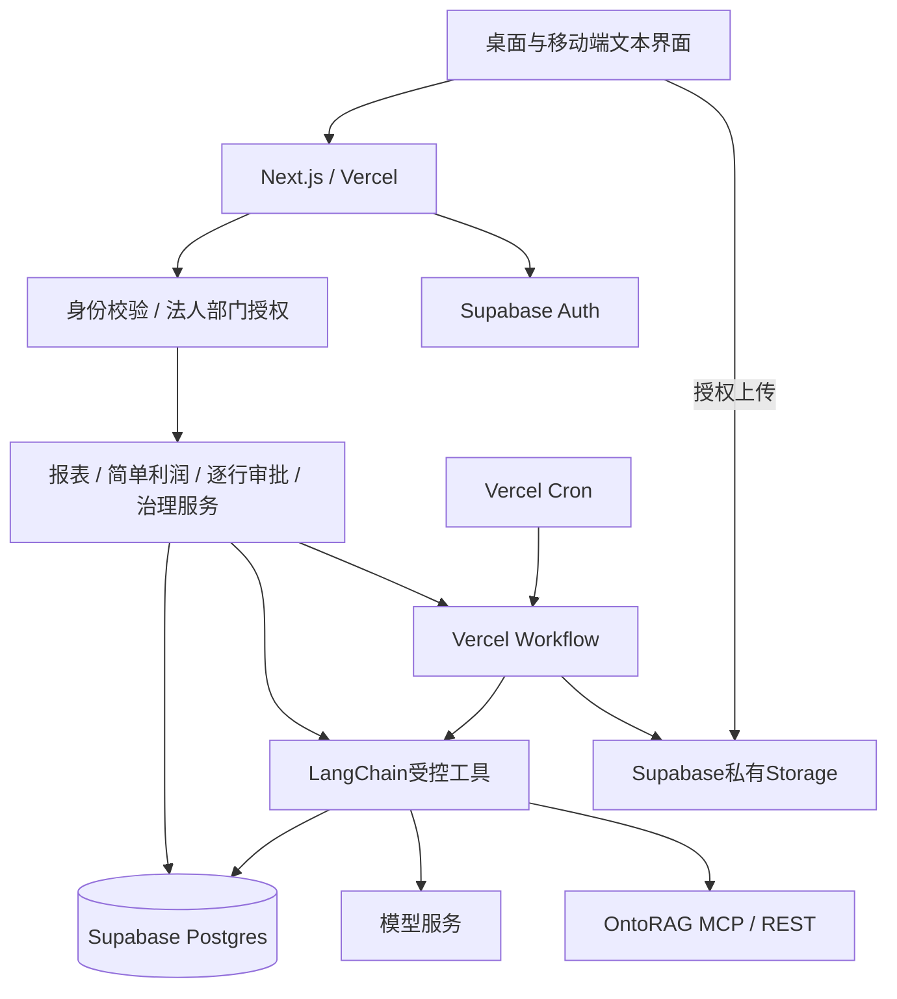

# 鲁银投资智能化平台技术栈方案 V1.0

日期：2026-11-04｜依据：PRD V0.2｜状态：技术选型基线，尚未创建应用、安装依赖或部署资源

## 1. 核心选型

采用TypeScript统一开发，Next.js全栈应用部署在Vercel，Supabase提供Postgres、Auth和Storage，LangChain JS作为智能体底座，Vercel Workflow承载持久异步任务。首期一个代码仓库、一个业务应用Vercel项目，经营与监管通过两个入口和权限菜单区分，共享账号、证据与审批。已有mini-ontorag维持独立部署，通过服务端REST/MCP接入。

|层级|选定技术|用途与边界|
|---|---|---|
|语言与运行时|TypeScript严格模式、Node.js 24.x、pnpm|前后端统一；Node版本显式固定到大版本，依赖精确版本写入锁文件|
|Web框架|Next.js 16.x App Router＋配套React版本|页面、服务端渲染、Route Handlers和同域API；补丁版本以搭建时安全稳定版和兼容性测试锁定|
|UI组件|Ant Design 6.x＋CSS Modules|企业表单、多级表头、固定列、分页、逐行审批；配套Next.js SSR样式集成；全站一套组件体系|
|少量图表|Apache ECharts|只用于必要趋势、占比与排名，动态按需加载；表格正文占比≥60%|
|前端请求与状态|原生fetch、React组件状态、URL筛选参数|首屏服务端取数；任务进度轮询；复杂共享状态出现后再引入状态库|
|接口与校验|Next.js Route Handlers、Zod|业务API、结构化输入输出、错误码与统一授权|
|数据库|现有Supabase Postgres|public保留现有ERP；新增业务与分析schema，不重复建设ERP|
|数据库访问|Postgres.js（postgres）＋Drizzle ORM|ERP报表用审核SQL/语义视图，业务写入用Drizzle与事务；schema变更统一SQL迁移|
|连接方式|Supabase Shared Transaction Pooler|Vercel函数通过Postgres协议连接，不走ERP HTTP API或用REST代替ERP分析查询|
|身份|Supabase Auth＋@supabase/ssr|Cookie会话、服务端身份校验；RBAC和法人/部门范围保存在业务权限表|
|文件|Supabase Storage私有桶＋签名上传/下载|原件、解析中间结果、报表导出；不依赖函数本地磁盘保存文件|
|大模型|DeepSeek deepseek-flash|API根地址https://api.deepseek.com；用于问数、评估、治理摘要及图片识别|
|智能体|LangChain JS/TS|NLP2SQL、调价理由评估、合同事实抽取、治理助手；受控工具和结构化输出|
|MCP|LangChain MCP适配器＋服务端授权包装|Streamable HTTP接mini-ontorag；文档归属由本平台校验|
|异步作业|Vercel Workflow SDK|文件解析、多行评估、报告生成、OntoRAG状态轮询、失败恢复|
|定时任务|Vercel Cron|触发每日尾库/协同建议和刷新作业；计算工作交给Workflow|
|表格文件|ExcelJS|XLSX读取和导出，支持多级表头、数值与说明；限制行列/压缩展开大小|
|文本文件|Mammoth、PDF.js（pdfjs-dist）|DOCX文本和文本型PDF提取；页码/单元格定位单独保留；不声称支持旧DOC或旧XLS|
|扫描与图片|DeepSeek deepseek-flash视觉能力＋文档页面预处理|服务端调用，扫描表格及盖章页按样本验证；低置信内容人工确认|
|PDF报表|@react-pdf/renderer＋嵌入中文字体|固定表格报告分页导出；大表后台分批，样式与中文字体需样张验收|
|数值与日期|Postgres NUMERIC/BIGINT、decimal.js、date-fns及时区工具|金额精度、吨换算、Asia/Shanghai和自然月回退，不以浮点数核算利润|
|SQL校验|pgsql-ast-parser＋自建白名单校验器|解析失败拒绝执行；仅支持已测试SQL子集，解析器不能独立承担安全隔离|
|测试|Vitest＋Playwright|利润/阈值/状态机、跨法人权限、报表与逐行审批端到端测试|
|监控|Vercel日志/Observability＋Supabase业务审计|request_id/job_id/agent_run关联；耗时、失败、调用量和成本；敏感原文不写平台日志|

上述版本为选定主版本基线，不是未经测试的完整package.json。搭建时核对Next/React/Ant Design SSR、Workflow与LangChain组合，锁定精确依赖，不使用无限漂移的latest。Node 24.x是本项目主动选择的运行版本，不依赖Vercel默认版本。

## 2. 部署边界



业务应用一个部署，经营入口/operation与监管入口/governance共享底座；权限判断与菜单展示分开。mini-ontorag作为既有外部服务，不并入业务应用发布。首期无需独立FastAPI或NestJS后端，避免两套应用鉴权和部署；重型解析需求证实超出Node函数能力时，再为该单项增加独立解析服务。

## 3. 数据库与权限设计

沿用现有ERP项目vyulbopmxltjnptuqmcp。建议schema分工：public为现有ERP来源；platform为账号映射、申请主从行、审批、治理、文件元数据和审计；analytics为批准的语义视图、利润结果、报表快照；ai为同义词、样例、提示/规则版本和调用记录。新增schema不默认暴露给Data API；正式变更另走迁移，不在定义技术栈时改数据库。

定义三个数据库角色：erp_analysis_ro仅具所需SELECT和受限函数执行权限；platform_app_rw只写平台业务数据且按权限读取所需来源；migration_owner仅供受控迁移，不供线上请求或模型使用。角色不得有BYPASSRLS，不使用postgres超级账号处理请求。模型生成SQL只进入专用只读执行器，不能借业务写账号执行。

Vercel通过Supabase事务池连接。Postgres.js模块级初始化，小连接池从max=1起步，prepare=false，启用TLS并验证项目支持的证书配置；总并发通过任务/请求配额控制，不只靠每实例池大小。生产参数依据部署区域、连接额度及压测调整。数据库迁移使用适合DDL的直连或会话连接，不混用应用事务池配置。[连接依据](https://supabase.com/docs/guides/database/connecting-to-postgres)

Auth令牌只证明身份；Postgres直接连接不会自动携带终端用户JWT。服务端验证身份后读取授权，事务内设置可信用户上下文（set_config的事务局部形式），由RLS/安全视图和显式法人范围共同约束。事务池不依赖跨事务session状态。上下文只能由可信服务代码设置，生成SQL禁止调用set_config、设置角色或写会话配置；事务结束即清除，跨请求隔离需测试。需要设置的具体claims与策略在建表时统一定义。

ERP若现有策略与新访问方式冲突，先在测试环境验证受限读取方案，不能简单关闭RLS。安全视图核对security_invoker语义及底层授权，避免默认所有者权限绕过。语义模型只向LangChain提供批准表/字段/连接，查询执行器校验AST、嵌套子查询、函数、系统目录、行数和超时，拒绝不支持语法。只读事务不能阻止一切危险SELECT函数，因此函数也需白名单。

身份权限以数据库成员关系为准，不使用用户可修改metadata授权。审批账号拥有鲁盐管理员业务权限，不等同于Supabase服务密钥或数据库管理员。

## 4. LangChain与异步任务分工

LangChain负责模型交互、工具调用、结构化输出、NLP2SQL语义映射和解释。确定性利润计算、库存规则、合同覆盖日期检查以及逐行审批由业务代码/SQL完成。

Workflow负责跨函数调用恢复和步骤重试；每个步骤完成一个有界任务，LangChain和Postgres访问放在正常Node步骤中，不放在可重放的流程编排体中。避免把整套多小时Agent循环作为一个步骤；按证据收集、单行评估、结果校验、保存拆分。业务库job状态用于产品展示，Workflow run_id用于执行跟踪，二者关联而不互相替代。[Workflow依据](https://vercel.com/docs/workflows)

首期不另加一套LangGraph持久化编排，避免与Workflow重复管理重试、状态与恢复。LangChain内部模型循环限定工具次数、token和耗时。只读模型步骤可重试，但仍可能重复计费；审批等业务写入以行版本、唯一幂等键和数据库事务去重。平台审核是数据库状态机中的单级人工动作，不是模型可调用的任意批准工具。

任务示例：上传完成→校验真实文件→解析→逐行识别→人工确认；提交申请→Workflow取证→按行有限并发评估→结果校验持久化→管理员逐行审核。OntoRAG上传后持久保存document_id，用Workflow等待再轮询，不在一个HTTP函数中持续sleep。浏览器先用授权轮询获取job进度；问数文本可用SSE流式返回，断线后可查已保存结果。

模型已确定为DeepSeek，模型标识严格使用`deepseek-flash`，API根地址`https://api.deepseek.com`，Chat Completions端点为`https://api.deepseek.com/chat/completions`。LangChain JS通过OpenAI兼容Chat Completions适配（@langchain/openai）接入，显式配置baseURL、模型名和服务端密钥，避免SDK默认端点或默认Responses路由改变调用方式。这里的OpenAI是接口协议适配，不是使用OpenAI模型。

问数、调价评估、合同/治理材料理解统一使用该模型，不自动切换其他供应商。官方当前列明支持工具调用、JSON输出、视觉及思考/非思考模式；实现时按任务显式配置模式，不依赖默认值。简单抽取、问数优先验证非思考模式；多证据评估可使用思考模式并设置预算。思考模式工具循环、结构化输出和视觉消息的适配兼容性必须以锁定LangChain版本实测，不把JSON输出能力等同于严格满足Zod业务schema。

所有模型结果仍经Zod及业务规则校验；格式无效可有界重试，失败转人工。扫描文件先分页面/区域转图片再调用视觉能力，保留原件页码，不假设模型直接解析任意文件。模型输出不证明印章或签名真伪。低清晰度和复杂表格仍须人工校对，不因选定模型而取消质量验证。

本次仅确认并记录模型配置，未提供或读取真实API密钥，未发起模型调用；既有mini-ontorag自身部署的模型配置独立，不能假定随本平台选型自动变更。[DeepSeek接口依据](https://api-docs.deepseek.com/)、[模型能力依据](https://api-docs.deepseek.com/quick_start/pricing/)

服务端配置约定（示例，不含真实密钥）：

```dotenv
DEEPSEEK_BASE_URL=https://api.deepseek.com
DEEPSEEK_MODEL=deepseek-flash
DEEPSEEK_API_KEY=<仅在Vercel服务端环境变量中设置>
```

密钥不得使用NEXT_PUBLIC前缀，不传给浏览器。保留模型请求名、供应商响应的版本信息（若返回）、提示版本、token用量和耗时，以便服务商更新同名模型后回归对比；不在本方案固定易变化的模型价格或服务商并发额度。


## 5. 文件、报告与OntoRAG

原件由浏览器使用短期授权直接上传Supabase私有Storage，再向API提交对象key与申请ID。服务端检查对象归属、实际大小、内容类型、哈希和可读性后启动任务，不能仅信任客户端文件名或“上传成功”状态。扫描件需独立OCR/多模态处理，文本PDF解析器本身不提供OCR。[上传参考](https://supabase.com/docs/guides/storage/uploads/resumable-uploads)

Vercel Function请求/响应有4.5 MB负载限制，所以不通过业务API转发大原件或直接返回大导出二进制；导出文件写Storage后返回受授权下载入口。[函数限制](https://vercel.com/docs/functions/limitations)

现有OntoRAG仅支持4 MiB及指定格式，与平台Storage可存大小独立：必须在调用外部上传前再次检查。DOCX/XLSX/图片先转换为受支持文本或PDF，超限按可追溯分段文档处理，保存原件—段—document_id关系；无法可靠分段则提示人工处理。MCP仅通过服务端包装访问，document_id与租户/法人/制度版本绑定，不能暴露外部全局列表工具。

PDF报告使用固定模板和中文字体，数据表与页面共享指标/快照，不用模型编造数字。大表采用分页、分文件或XLSX数据附件，首期不承诺无限行单文件。导出审批意见、申请理由等用户文本按字符串写Excel，避免变成公式。

## 6. 业务实现约定

- 报表：SQL汇总＋Ant Design Table，服务端分页/排序/筛选；ECharts按需，不把全部数据拉浏览器运算。
- NLP2SQL：语义模型、同义词、别名、样例SQL以表存储；发布经管理员确认，带版本；受限视图查询，不默认调用可探索全库的SQL Agent工具包。
- 利润：R−数量×有效单位成本，NUMERIC计算；不做费用分摊；缺成本不可计算。
- 调价：主表容器＋独立行状态＋行级评估快照＋审批事件；通过、驳回和待审可同单并存。
- 尾库：Asia/Shanghai当前日回退3自然月，首次入库早于截止日且0<剩余量<0.5吨；作为确定性规则测试。
- 治理：制度要求、适用范围、证据、预检结果和管理员审批分开存储；平台审批不替代治理机构正式决议。
- 移动端：响应式Web，文本问数；不做语音采集或语音识别。

## 7. 工程结构与环境

```text
src/app/(auth)/                 登录
src/app/(platform)/operation/   经营入口
src/app/(platform)/governance/  监管入口
src/app/api/                   授权业务接口
src/components/                表格、表单、证据和简图
src/server/auth/               身份与授权
src/server/db/                 角色连接及受控查询
src/server/domain/             利润、申请、治理、合同规则
src/server/agents/             LangChain与工具包装
src/server/semantic/            指标词典与SQL校验
src/workflows/                 持久异步任务与步骤
src/server/files/              上传校验、解析、导出
supabase/migrations/           唯一SQL迁移历史
 tests/                        Vitest及Playwright
```

前后端共用Zod契约，server-only隔离数据库、密钥与模型代码。迁移只维护一条SQL历史，不同时生成两套Drizzle和Supabase迁移历史；Drizzle用于类型/访问层。

环境变量规划：公开项仅SUPABASE_URL和发布密钥；服务端项包括ERP_READONLY_DATABASE_URL、APP_DATABASE_URL、ONTORAG_BASE_URL、ONTORAG_SERVICE_API_KEY、DEEPSEEK_BASE_URL、DEEPSEEK_API_KEY、DEEPSEEK_MODEL及CRON_SECRET；若Storage后端确需服务密钥，单独服务端持有且调用前完成权限验证。正式命名需按Next.js公开前缀规范落实，不能把数据库或服务密钥标记为NEXT_PUBLIC。

开发、预览、生产分离。Vercel Preview默认连接测试Supabase，不连接生产ERP写角色；预览文件和模型调用也使用独立配置。Vercel函数及Workflow执行地域尽量靠近现有Supabase地域；Workflow run数据地域与SDK版本及平台配置须在上线前核对，不假设自动跟随函数地域。现有mini-ontorag独立凭据与发布周期保留。

## 8. 验证与落地顺序

1. Next.js/Ant Design SSR及中文表格样页，确认移动端和60%表格布局。
2. Supabase Auth、数据库事务池只读连接、法人授权与RLS集成测试，验证事务上下文不串租户。
3. 固定报表、简单利润与逐行审批数据库事务；对账后开放。
4. LangChain语义问数和MCP授权包装，覆盖未知字段、越权、函数注入与解析失败。
5. Workflow小规模验证：重试、断线恢复、文档转换、OntoRAG轮询、费用可观测，确认所用套餐和步骤时限可满足。
6. 文件导出、每日尾库刷新与端到端验收；确认地域、备份、恢复和数据留存。

首期不引入Redis、Elasticsearch、独立向量库、Kubernetes或额外消息中间件；已有Postgres、Storage、Workflow覆盖当前需要。缓存先用带权限版本/租户/快照的数据库结果缓存。若实际负载表明查询、检索或任务执行不足，再据压测单独增加组件。

## 9. 来源与与PRD关系

- [Next.js App Router](https://nextjs.org/docs/app)、[Ant Design Table](https://ant.design/components/table/)、[Vercel Node运行时](https://vercel.com/docs/functions/runtimes/node-js/node-js-versions)：框架、企业表格与Node 24可选运行时依据。
- [LangChain JS](https://docs.langchain.com/oss/javascript/langchain/overview)、[MCP适配](https://docs.langchain.com/oss/javascript/langchain/mcp)：JS智能体和MCP能力依据。
- [Supabase SSR身份](https://supabase.com/docs/guides/auth/server-side/nextjs)：Next.js服务端会话参考。
- [ExcelJS](https://github.com/exceljs/exceljs)、[SQL AST解析器](https://github.com/oguimbal/pgsql-ast-parser)：文件和SQL子集工具；需对生产样本验证。
- 本地本体层docs/INTEGRATION.md：用户OntoRAG部署的接口契约。

本文件细化并覆盖PRD V0.2中“Postgres驱动/SQLAlchemy”和未定语言表述：正式选型为TypeScript、Postgres.js＋Drizzle、LangChain JS、Vercel Workflow；业务范围仍以PRD V0.2及功能清单为准。本次仅输出技术选型，不变更云端资源或ERP数据库。
